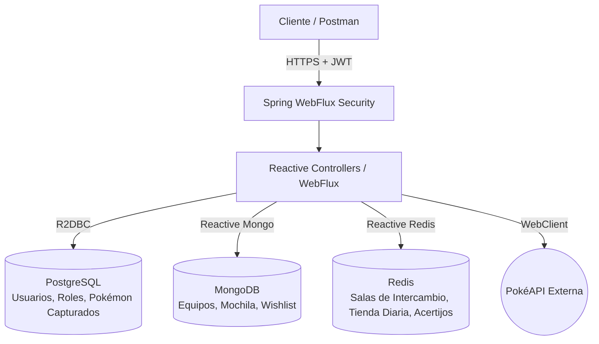

# ⚡ PokéEngine — Reactive Backend API


API RESTful construida con **Spring WebFlux** que simula el ecosistema completo de un entrenador Pokémon: captura probabilística basada en *catch rate* real, gestión de equipos, guardería con progresión temporal, tienda dinámica con rotación diaria, sistema de acertijos e intercambios en tiempo real entre entrenadores.

---

## ✨ Características Principales

* **🎯 Motor de Captura Probabilística:** Cálculo dinámico en tiempo real basado en el *catch rate* oficial obtenido desde PokéAPI, multiplicadores de Pokéball y estado del Pokémon.
* **🛡️ Gestión de Equipo y Mochila:** Administración reactiva del equipo activo (máximo 6 Pokémon), almacenamiento en PC, inventario de ítems y *wishlist*.
* **🥚 Guardería con Progresión Temporal:** Sistema de crianza y ganancia de experiencia basada en marcas de tiempo (*timestamps*) sin bloquear hilos del servidor.
* **🛒 Tienda Dinámica y Acertijos:** Rotación automática de inventario diario y retos diarios gestionados mediante expiración de claves (*TTL*) en caché.
* **🔄 Intercambios en Tiempo Real:** Salas de intercambio efímeras entre entrenadores.
* **🔐 Seguridad Reactiva:** Autenticación y autorización stateless mediante **Spring Security WebFlux + JWT**.

---

## 🏗️ Arquitectura y Persistencia Políglota

El sistema está diseñado bajo el paradigma **Reactivo (Project Reactor)** utilizando *drivers* no bloqueantes de extremo a extremo  y una estrategia de **persistencia políglota** elegida según la naturaleza y patrón de acceso de cada dato:



### ¿Por qué tres motores de base de datos?

| Motor | Driver Reactivo | Responsabilidad | Justificación Técnica |
| :--- | :--- | :--- | :--- |
| **PostgreSQL** | `R2DBC` | Usuarios, credenciales, roles y registro histórico de Pokémon capturados. | Garantiza integridad referencial y transacciones ACID para la propiedad crítica de los Pokémon. |
| **MongoDB** | `Reactive Mongo` | Composición de equipos, mochila de ítems y *wishlist*. | Estructuras JSON flexibles y anidadas que evitan *joins* costosos en lecturas frecuentes del perfil. |
| **Redis** | `Lettuce (Reactive)` | Salas de intercambio, tienda diaria, acertijos y caché de PokéAPI. | Soporte para expirar tiendas diarias y salas inactivas automáticamente. |

---

## 🛠️ Stack Tecnológico

* **Lenguaje & Framework:** Java 21, Spring Boot 3.x, Spring WebFlux (Project Reactor: `Mono` / `Flux`).
* **Seguridad:** Spring Security Reactive, JSON Web Tokens (JJWT).
* **Persistencia No Bloqueante:** Spring Data R2DBC, Spring Data Reactive MongoDB, Spring Data Reactive Redis.
* **Cliente HTTP Reactivo:** `WebClient` con manejo de resiliencia.

---

## 🚀 Instalación y Ejecución Local

### Prerrequisitos
* **JDK 21** o superior
* **Docker** y **Docker Compose** (para levantar PostgreSQL, MongoDB y Redis)
* **Maven 3.9+**

### 1. Clonar el repositorio
```bash
git clone https://github.com/pedroaldama/PokeEngine
```

### 2. Levantar la infraestructura con Docker
```bash
docker-compose up -d
```

### 3. Configurar variables de entorno
Crea un archivo `.env` o exporta las siguientes variables antes de ejecutar la aplicación:

```env
DB_URL: 
DB_USER: 
DB_PASSWORD: 
MONGO: 

R2DBC_URL=r2dbc:postgresql://localhost:5432/pokeengine
DB_USERNAME=postgres
DB_PASSWORD=postgres

MONGO_URI=mongodb://localhost:27017/pokeengine
REDIS_HOST=localhost
REDIS_PORT=6379
POKEAPI_BASE_URL=https://pokeapi.co/api/v2
```

### 4. Ejecutar la aplicación
```bash
./mvnw spring-boot:run
```
Una vez iniciada, la documentación interactiva estará disponible en:
👉 `http://localhost:8080/webjars/swagger-ui/index.html`

---

## 📡 Principales Endpoints

| Método | Endpoint | Descripción | Auth |
| :--- | :--- | :--- | :---: |
| `POST` | `/api/v1/auth/register` | Registro de nuevo entrenador. | ❌ |
| `POST` | `/api/v1/auth/login` | Autenticación y generación de token JWT. | ❌ |
| `POST` | `/api/v1/pokemon/catch/{pokemonId}` | Intento de captura usando una Pokéball específica. | ✅ |
| `GET` | `/api/v1/trainer/team` | Obtiene el equipo activo y mochila del entrenador. | ✅ |
| `POST` | `/api/v1/daycare/deposit` | Deposita un Pokémon en la guardería. | ✅ |
| `GET` | `/api/v1/shop/daily` | Consulta los artículos disponibles en la tienda del día. | ✅ |
| `POST` | `/api/v1/riddles/solve` | Envía la respuesta al acertijo activo para ganar recompensas. | ✅ |
| `POST` | `/api/v1/trades/rooms` | Crea o se une a una sala de intercambio en tiempo real. | ✅ |

---

